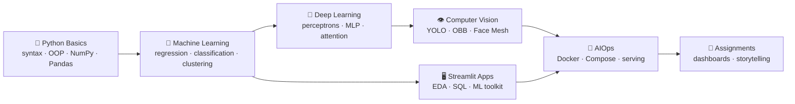
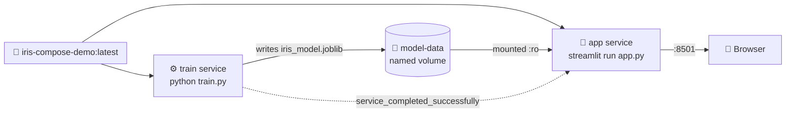

<div align="center">

# 🎓 Autumn Internship Program on Data Science 2026

### IDEAS – Technology Innovation Hub · Indian Statistical Institute (ISI), Kolkata

_My coursework, lab notebooks, apps and assignments from the internship. It covers Python fundamentals, machine learning, deep learning, computer vision and MLOps with Docker._

<br>


</div>

---

## 📑 Table of Contents

- [Overview](#-overview)
- [Learning Path](#-learning-path)
- [Repository Structure](#-repository-structure)
- [Modules](#-modules)
  - [1. Python Basics](#1--python-basics)
  - [2. Machine Learning](#2--machine-learning-ml)
  - [3. Deep Learning](#3--deep-learning-dl)
  - [4. Computer Vision](#4--computer-vision-cv)
  - [5. AIOps: Docker for ML](#5--aiops-docker-for-ml)
  - [6. Streamlit Apps](#6--streamlit-apps-codes)
  - [7. Assignments](#7--assignments)
- [Getting Started](#-getting-started)
- [Datasets](#-datasets)
- [Tech Stack](#-tech-stack)
- [Acknowledgements](#-acknowledgements)
- [Author](#-author)

---

## 🌟 Overview

This repository collects my work from the **IDEAS-TIH Autumn Internship Program on Data Science 2026**. It starts with Python syntax and ends with machine-learning models served from Docker containers.

|                         | What you'll find                                                                                         |
| ----------------------- | -------------------------------------------------------------------------------------------------------- |
| 📓 **15 notebooks**     | Hands-on classes on Python, regression, classification, clustering, neural networks, attention, and YOLO |
| 🖥️ **3 Streamlit apps** | A 5-page data-science toolkit, a DuckDB SQL explorer, and a styled frontend demo                         |
| 🐳 **5 Docker labs**    | From `docker pull` to a two-service Docker Compose train-and-serve pipeline                              |
| 👁️ **Computer vision**  | YOLO object detection, oriented bounding boxes on aerial imagery, and real-time virtual lipstick         |
| 📝 **Assignments**      | COVID-19 dashboard, data ingestion with reports, data storytelling, and an AI case study                 |

---

## 🧭 Learning Path



---

## 📂 Repository Structure

```
AUTUMN INTERNSHIP PROGRAM ON DATA SCIENCE 2026/
│
├── IDEAS_TIH_Autumn_Internship_2026_Python_Basics/   # 🐍 Python fundamentals (Classes 1–4)
│
├── ML/                                                # 🤖 Applied machine learning
│   ├── Class_1_ML_Pipeline_Text.ipynb                 #    ML pipeline + spam/ham text classification
│   ├── Class_2_Linear Regression.ipynb                #    California house-price regression
│   ├── Class_2_LogisticRegression.ipynb               #    Breast-cancer diagnosis
│   ├── Class_3_LogisticRegression_MLP.ipynb           #    From logistic regression to MLPs (PyTorch)
│   ├── Class_3_Introduction_To_Clustering.ipynb       #    K-Means & DBSCAN
│   └── ML_Practice.ipynb                              #    Consolidated practice notebook
│
├── DL/
│   └── ASP_Attention_demo.ipynb                       # 🧠 QKV & multi-head attention from scratch
│
├── CV/                                                # 👁️ Computer vision
│   ├── 01A_yolo_cv_soccer.ipynb                       #    YOLO detection on football scenes
│   ├── 01B_overhead_image_analytics.ipynb             #    Oriented bounding boxes on DOTA aerial images
│   ├── virtual_makeup_lipstick.py                     #    Real-time webcam virtual lipstick
│   ├── requirements.txt
│   └── irw01 … irw11/                                 #    Thermal-infrared video frame sequences
│
├── AIOps/                                             # 🐳 Docker for ML (Blocks 1–5)
│   ├── block1/   # Image management: pull, list, run, clean up
│   ├── block2/   # Interactive containers: compile & run C++ inside gcc:14
│   ├── block3/   # Dev Containers + MediaPipe virtual-makeup prototype
│   ├── block4/   # Train an Iris model → serve it with Streamlit in Docker
│   └── block5/   # Docker Compose: separate train & app services with a shared volume
│
├── CODES/                                             # 🖥️ Streamlit applications
│   ├── ds_app/                                        #    Multi-page Data Science Toolkit
│   ├── duckdb_demo.py                                 #    DuckDB SQL Explorer
│   ├── Basic_frontend.py                              #    Streamlit layout & styling demo
│   ├── Sample-datasets/                               #    Small CSVs for the apps
│   ├── Student_Psychological_Factors.csv
│   └── Professional_Sales_EDA_Dataset_1000_rows.xlsx
│
└── ASSIGNMENT/                                        # 📝 Assignments & case study
    ├── Assignment.md
    ├── Coding_by_AI_Case_Study.docx
    └── COVID -19 dataset/
```

---

## 📚 Modules

### 1. 🐍 Python Basics

📁 [`IDEAS_TIH_Autumn_Internship_2026_Python_Basics/`](IDEAS_TIH_Autumn_Internship_2026_Python_Basics/)

| Class       | Topics                                                                                                                                                                           |
| ----------- | -------------------------------------------------------------------------------------------------------------------------------------------------------------------------------- |
| **Class 1** | Comments, variables, data types, implicit and explicit type casting, string operations and slicing, conditionals, `for` loops and `range()`, dry runs, pattern-printing programs |
| **Class 2** | Lists and slicing, string methods (`strip`, `replace`, `find`), functions, `while` loops, prime and Armstrong-number programs, recursion (factorial, power)                      |
| **Class 3** | List methods (`append`, `pop`, `insert`), list comprehensions, dictionaries, tuples, sets, classes and objects, constructors and `self`                                          |
| **Class 4** | OOP pillars (abstraction, encapsulation, inheritance), NumPy array creation, introduction to Pandas                                                                              |

---

### 2. 🤖 Machine Learning (`ML/`)

📁 [`ML/`](ML/)

| Notebook                                                                      | What it covers                                                                                                                                                                              | Dataset                 |
| ----------------------------------------------------------------------------- | ------------------------------------------------------------------------------------------------------------------------------------------------------------------------------------------- | ----------------------- |
| [Class 1: ML Pipeline & Text](ML/Class_1_ML_Pipeline_Text.ipynb)              | Supervised vs. unsupervised learning, train/test splits, missing values, tokenization, Bag-of-Words, **TF-IDF**, Naive Bayes vs. Logistic Regression, precision/recall/F1, confusion matrix | SMS Spam Collection     |
| [Class 2: Linear Regression](ML/Class_2_Linear%20Regression.ipynb)            | Regression intuition, a mini activity, and a **house-price prediction** project evaluated with MAE                                                                                          | California Housing      |
| [Class 2: Logistic Regression](ML/Class_2_LogisticRegression.ipynb)           | Binary classification, **feature scaling**, decision regions (`mlxtend`), why the confusion matrix matters in medicine                                                                      | Breast Cancer Wisconsin |
| [Class 3: Logistic Regression → MLP](ML/Class_3_LogisticRegression_MLP.ipynb) | The bridge to deep learning: single-layer perceptron, the 4 math pillars of neural nets, hyperparameters, **multi-layer perceptron in PyTorch**, decision boundaries                        | Breast Cancer Wisconsin |
| [Class 3: Clustering](ML/Class_3_Introduction_To_Clustering.ipynb)            | Unsupervised learning, **K-Means** (with animation), real-world uses, **DBSCAN**, K-Means vs. DBSCAN                                                                                        | Synthetic data          |
| [ML Practice](ML/ML_Practice.ipynb)                                           | All of the classes above in one notebook for revision                                                                                                                                       | —                       |

---

### 3. 🧠 Deep Learning (`DL/`)

📁 [`DL/ASP_Attention_demo.ipynb`](DL/ASP_Attention_demo.ipynb): **Understanding QKV Attention From Scratch in PyTorch**

This notebook builds the core mechanism behind Transformers step by step:

1. Toy input embeddings
2. Q, K, V projection matrices
3. Attention scores: `Q · Kᵀ`
4. Scaling by `√dₖ` and why it is needed
5. Softmax into attention weights
6. Weighted sum of values
7. Visualising the attention matrix
8. Self-attention
9. **Multi-head attention** implemented from scratch and tested

> 📖 Based on _Vaswani et al., "Attention Is All You Need" (NeurIPS 2017)_.

---

### 4. 👁️ Computer Vision (`CV/`)

📁 [`CV/`](CV/)

| Item                                                                      | Description                                                                                                                                                                                                                                                                                                                           |
| ------------------------------------------------------------------------- | ------------------------------------------------------------------------------------------------------------------------------------------------------------------------------------------------------------------------------------------------------------------------------------------------------------------------------------- |
| [**01A: YOLO on Soccer Scenes**](CV/01A_yolo_cv_soccer.ipynb)             | Runs a pretrained **YOLO26n** detector on the [Football Image Dataset](https://github.com/skaczylo/Football-Image-Dataset), filtered to `person` and `sports ball`. Compares GPU and CPU inference time and FPS, and shows predictions in image grids.                                                                                |
| [**01B: Oriented Bounding Boxes**](CV/01B_overhead_image_analytics.ipynb) | A workshop on moving from axis-aligned boxes to **oriented bounding boxes (OBB)** for satellite and drone imagery. It parses YOLO-OBB labels, draws AABB vs. OBB, plots the class distribution, and runs inference with **YOLO26n-OBB** on DOTA128 (15 classes, e.g. plane, ship, harbor). It also covers the `xywhr` representation. |
| [**virtual_makeup_lipstick.py**](CV/virtual_makeup_lipstick.py)           | **Real-time virtual lipstick** from a webcam. MediaPipe Face Mesh landmarks give a lip mask (outer minus inner polygon), which is feathered with a Gaussian blur and alpha-blended so the lip texture shows through. Press **C** to cycle 5 shades and **Q** to quit.                                                                 |
| `irw01/` … `irw11/`                                                       | 11 **thermal-infrared video sequences** (10,190 frames, 320×240 JPEG) of a person walking outdoors, kept as raw frames for CV experiments                                                                                                                                                                                             |

> 💡 The YOLO notebooks download their datasets with `git clone` and `wget` and use `/content/` paths, so they are easiest to run on **Google Colab** with a GPU runtime.

---

### 5. 🐳 AIOps: Docker for ML

📁 [`AIOps/`](AIOps/)

Five blocks that build up from basic Docker commands to a train-and-serve pipeline with Compose.

| Block                        | Theme                  | Key commands and concepts                                                                                                             |
| ---------------------------- | ---------------------- | ------------------------------------------------------------------------------------------------------------------------------------- |
| [**Block 1**](AIOps/block1/) | Image management       | `docker pull`, `images`, `run hello-world`, `ps` vs. `container ls`, `container prune`, `rmi`                                         |
| [**Block 2**](AIOps/block2/) | Interactive containers | Run `gcc:14` detached (`-dit`), `docker cp` a C++ file in, `exec -it`, compile & run, then `stop`/`start`/`rm`                        |
| [**Block 3**](AIOps/block3/) | Docker for prototyping | Attach **VS Code Dev Containers** to a running `python:3.11-slim` container and run a **MediaPipe virtual-makeup** notebook inside it |
| [**Block 4**](AIOps/block4/) | Model serving          | Train a Logistic Regression **Iris classifier**, pickle it, and serve it from a **Streamlit** app built into a Docker image           |
| [**Block 5**](AIOps/block5/) | Docker Compose         | One image, **two services**: `train` writes the model to a named volume, and `app` mounts it read-only after training completes       |

#### Block 5 architecture



```bash
cd AIOps/block5
docker compose up --build          # build → train → serve
# open http://localhost:8501
docker compose run --rm train      # retrain while the app keeps running
docker compose restart app         # reload the new model
docker compose down -v             # clean up, including the volume
```

---

### 6. 🖥️ Streamlit Apps (`CODES/`)

📁 [`CODES/`](CODES/)

#### 🔬 Data Science Toolkit: [`CODES/ds_app/`](CODES/ds_app/)

A **multi-page Streamlit app** that runs a full data-science pipeline on any CSV. Data is kept in `st.session_state` and passed from page to page.


| Page                    | Features                                                                                                                                                                                                 |
| ----------------------- | -------------------------------------------------------------------------------------------------------------------------------------------------------------------------------------------------------- |
| **📂 Upload & Preview** | Row, column, missing-value and duplicate counts; adjustable preview; column info table; descriptive statistics; Excel export                                                                             |
| **🧹 Data Cleaning**    | Drop duplicates; impute numeric columns (mean/median/mode/drop) and categorical columns (mode/"Unknown"/drop); drop columns; convert dtypes; CSV export                                                  |
| **📊 EDA**              | Histogram, box plot and KDE; top-N value counts; correlation heatmap; scatter plot with optional hue; missing-value map                                                                                  |
| **⚖️ Normalization**    | Min-Max, Standard (Z-score) or Robust scaling, before/after statistics, distribution comparison                                                                                                          |
| **🤖 Classification**   | Logistic Regression, Decision Tree or Random Forest with adjustable hyperparameters; accuracy, confusion matrix and classification report; feature importances or coefficients; downloadable predictions |

#### 🦆 DuckDB SQL Explorer: [`CODES/duckdb_demo.py`](CODES/duckdb_demo.py)

Upload a CSV or Parquet file and practise SQL on an in-memory **DuckDB** `employees` table:

- **DDL:** `DESCRIBE`, `ALTER TABLE … ADD/RENAME/DROP COLUMN`, `SHOW TABLES`
- **DML:** `SELECT` with `WHERE`, `ORDER BY`, `LIMIT` and `GROUP BY` aggregates, plus `INSERT`, `UPDATE` and `DELETE`
- **Custom SQL** editor with CSV download of results
- **Quick stats** (count, mean, min, max, std dev) for any numeric column
- A **Restore** button to reset the table, and an optional persistent `.duckdb` file

> Use [`Sample-datasets/sample_duckdb_data.csv`](CODES/Sample-datasets/sample_duckdb_data.csv). The preset queries expect the columns `id, name, age, salary, department`.

#### 🌍 Basic Frontend: [`CODES/Basic_frontend.py`](CODES/Basic_frontend.py)

A travel-blog page that shows Streamlit layout basics: a sidebar with anchor navigation, metrics, columns, dividers, and custom CSS for coloured headers.

---

### 7. 📝 Assignments

📁 [`ASSIGNMENT/`](ASSIGNMENT/): full brief in [`Assignment.md`](ASSIGNMENT/Assignment.md)

| #   | Assignment                                                                                                        | Tools                |
| --- | ----------------------------------------------------------------------------------------------------------------- | -------------------- |
| 1   | **COVID-19 Dashboard** with bar, line and pie charts                                                              | Streamlit, ReportLab |
| 2   | **Ingestion Page**: upload a CSV into a database and generate a summary report                                    | Streamlit, ReportLab |
| 3   | **Explain a Result in 30 Seconds**: explain a churn model's recall/precision trade-off to a non-technical manager | MS Word              |
| 4   | **Pyramid Principle & the 7 Cs**: data storytelling and professional email writing                                | MS Word              |

📄 **Case study:** [`Coding_by_AI_Case_Study.docx`](ASSIGNMENT/Coding_by_AI_Case_Study.docx), _"Coding by Artificial Intelligence: How AI Is Reshaping Software Development"_. It is organised with the Pyramid Principle (headline → supporting points → evidence → details) and draws on the GitHub Copilot experiment, Stack Overflow surveys, the Stanford/NYU security study, the METR trial and SWE-bench.

---

## 🚀 Getting Started

### Prerequisites

- **Python 3.10+**
- **Jupyter** (or VS Code with the Jupyter extension), or **Google Colab**
- **Docker Desktop** for the AIOps blocks
- A **webcam** for the real-time virtual-makeup script

### 1. Clone the repository

```bash
git clone https://github.com/Rajdip-Dhar/AUTUMN-INTERNSHIP-PROGRAM-ON-DATA-SCIENCE-2026.git
cd AUTUMN-INTERNSHIP-PROGRAM-ON-DATA-SCIENCE-2026
```

### 2. Create a virtual environment

```bash
python -m venv .venv
# Windows
.venv\Scripts\activate
# macOS / Linux
source .venv/bin/activate
```

### 3. Run what you need

<details>
<summary><b>📓 Notebooks (Python basics, ML, DL)</b></summary>

```bash
pip install jupyter numpy pandas matplotlib seaborn scikit-learn mlxtend torch
jupyter notebook
```

</details>

<details>
<summary><b>🔬 Data Science Toolkit (multi-page Streamlit)</b></summary>

```bash
pip install -r CODES/ds_app/requirements.txt openpyxl
streamlit run CODES/ds_app/Home.py
```

</details>

<details>
<summary><b>🦆 DuckDB SQL Explorer</b></summary>

```bash
pip install streamlit duckdb pandas pyarrow
streamlit run CODES/duckdb_demo.py
```

</details>

<details>
<summary><b>👄 Real-time virtual lipstick</b></summary>

```bash
pip install -r CV/requirements.txt
python CV/virtual_makeup_lipstick.py
# C = change colour · Q = quit
```

</details>

<details>
<summary><b>🎯 YOLO notebooks</b></summary>

Open `CV/01A_yolo_cv_soccer.ipynb` or `CV/01B_overhead_image_analytics.ipynb` in **Google Colab**, set **Runtime → GPU**, and run all cells. The notebooks install `ultralytics` and download their datasets themselves.

</details>

<details>
<summary><b>🌸 Iris classifier in Docker (Block 4)</b></summary>

```bash
cd AIOps/block4
pip install scikit-learn && python train.py     # produces iris_model.pkl
docker build -t iris-streamlit .
docker run -p 8501:8501 iris-streamlit
# open http://localhost:8501
```

</details>

---

## 📊 Datasets

| Dataset                                                                       | Location / Source                                                                                            | Used in                     |
| ----------------------------------------------------------------------------- | ------------------------------------------------------------------------------------------------------------ | --------------------------- |
| COVID-19 (country-wise, day-wise, full grouped, USA county-wise, Worldometer) | [`ASSIGNMENT/COVID -19 dataset/`](ASSIGNMENT/COVID%20-19%20dataset/) (from Kaggle)                           | Assignment 1                |
| Sales EDA dataset (1,000 rows × 26 cols)                                      | [`CODES/Professional_Sales_EDA_Dataset_1000_rows.xlsx`](CODES/Professional_Sales_EDA_Dataset_1000_rows.xlsx) | EDA practice                |
| Student psychological factors (1,000 rows × 17 cols)                          | [`CODES/Student_Psychological_Factors.csv`](CODES/Student_Psychological_Factors.csv)                         | DS Toolkit                  |
| Pass/Fail student data (100 rows)                                             | [`CODES/Sample-datasets/Pass-Fail Data.csv`](CODES/Sample-datasets/Pass-Fail%20Data.csv)                     | DS Toolkit (classification) |
| Employees sample (5 rows)                                                     | [`CODES/Sample-datasets/sample_duckdb_data.csv`](CODES/Sample-datasets/sample_duckdb_data.csv)               | DuckDB Explorer             |
| Thermal-IR walking sequences                                                  | [`CV/irw01–irw11/`](CV/)                                                                                     | CV experiments              |
| SMS Spam Collection                                                           | Downloaded in the notebook                                                                                   | ML Class 1                  |
| California Housing · Breast Cancer · Iris                                     | Built into `scikit-learn`                                                                                    | ML Classes 2–3, AIOps       |
| Football Image Dataset                                                        | [skaczylo/Football-Image-Dataset](https://github.com/skaczylo/Football-Image-Dataset)                        | CV 01A                      |
| DOTA128                                                                       | [Ultralytics assets](https://github.com/ultralytics/assets/releases)                                         | CV 01B                      |

---

## 🛠️ Tech Stack

| Area                 | Tools                                                                                                                  |
| -------------------- | ---------------------------------------------------------------------------------------------------------------------- |
| **Language**         | Python                                                                                                                 |
| **Data**             | NumPy, Pandas, DuckDB, openpyxl                                                                                        |
| **Visualisation**    | Matplotlib, Seaborn, mlxtend                                                                                           |
| **Machine Learning** | scikit-learn (Linear/Logistic Regression, Naive Bayes, Decision Tree, Random Forest, K-Means, DBSCAN, scalers, TF-IDF) |
| **Deep Learning**    | PyTorch                                                                                                                |
| **Computer Vision**  | Ultralytics YOLO26 (detect + OBB), OpenCV, MediaPipe Face Mesh                                                         |
| **Apps**             | Streamlit                                                                                                              |
| **MLOps**            | Docker, Docker Compose, VS Code Dev Containers, joblib/pickle                                                          |
| **Communication**    | Pyramid Principle, 7 Cs of communication, ReportLab, MS Word                                                           |

---

## 🙏 Acknowledgements

- **IDEAS – Technology Innovation Hub, Indian Statistical Institute (ISI), Kolkata**, for organising the Autumn Internship Program 2026.
- **Dr. Sujoy Kumar Biswas**, Head of Research & Innovation, IDEAS-TIH, and Founder of [AIMP LABS](https://www.aimplabs.org), who wrote the Computer Vision and AIOps material.
- **Aditya Shankar Pal**, who wrote the QKV attention tutorial.
- The open-source communities behind scikit-learn, PyTorch, Ultralytics, MediaPipe, Streamlit, DuckDB and Docker.

> ⚠️ Instructional material in this repository belongs to its original authors and is shared here for learning purposes.

---

## 👤 Author

**Rajdip Dhar**, Data Science Intern, IDEAS-TIH Autumn Internship 2026

[](https://github.com/RajdipDhar2007)

<div align="center">

⭐ **If you find this repository useful, please consider giving it a star!** ⭐

</div>
