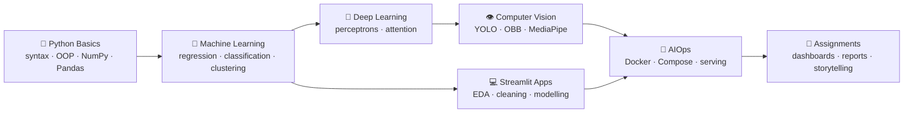
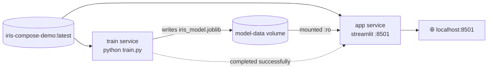

<div align="center">

---

## 📑 Table of Contents

- [About](#-about)
- [At a Glance](#-at-a-glance)
- [Learning Path](#-learning-path)
- [Repository Structure](#-repository-structure)
- [Modules](#-modules)
  - [1. Python Basics](#1--python-basics)
  - [2. Machine Learning](#2--machine-learning)
  - [3. Deep Learning](#3--deep-learning)
  - [4. Computer Vision](#4--computer-vision)
  - [5. AIOps: Docker for ML](#5--aiops-docker-for-ml)
  - [6. CODES: Streamlit Apps](#6--codes-streamlit-apps)
  - [7. Assignments](#7--assignments)
- [Getting Started](#-getting-started)
- [Datasets](#-datasets)
- [Troubleshooting](#-troubleshooting)
- [Acknowledgements](#-acknowledgements)
- [License](#-license)

---

## 📖 About

This repository holds the course material, hands-on notebooks, projects and assignments from the **IDEAS-TIH Autumn Internship 2026** in Data Science. The course starts with the Python language and works up to:

- classical **machine learning** with scikit-learn,
- **neural networks and attention** from scratch in PyTorch,
- **object detection** with YOLO (including oriented bounding boxes for satellite imagery),
- **face-landmark computer vision** with MediaPipe,
- **containerised ML deployment** with Docker and Docker Compose,
- interactive **data-science web apps** with Streamlit and DuckDB.

Every module is meant to be run, not just read: open the notebook, execute the cells, change values and see what happens.

---

## ✨ At a Glance

| Module                                                            | What you'll find                                                                         | Key tools                           |
| ----------------------------------------------------------------- | ---------------------------------------------------------------------------------------- | ----------------------------------- |
| 🐍[Python Basics](IDEAS_TIH_Autumn_Internship_2026_Python_Basics/) | 4 classes: syntax → OOP → NumPy → Pandas                                              | Python, NumPy, Pandas               |
| 🤖[Machine Learning](ML/)                                          | ML pipeline, text classification, regression, classification, clustering, perceptrons    | scikit-learn, mlxtend, PyTorch      |
| 🧠[Deep Learning](DL/)                                             | QKV self-attention and multi-head attention built from scratch                           | PyTorch                             |
| 👁️[Computer Vision](CV/)                                         | YOLO detection on football scenes, YOLO-OBB on aerial images, real-time virtual lipstick | Ultralytics YOLO, OpenCV, MediaPipe |
| 🐳[AIOps](AIOps/)                                                  | 5 progressive Docker blocks, ending in a train → serve pipeline with Compose            | Docker, Docker Compose, Streamlit   |
| 💻[CODES](CODES/)                                                  | A 5-page data-science toolkit app, a DuckDB SQL explorer and a Streamlit layout demo     | Streamlit, DuckDB, seaborn          |
| 📝[Assignments](ASSIGNMENT/)                                       | Dashboards, ingestion and reporting, and data-storytelling exercises                     | Streamlit, ReportLab, MS Word       |

---

## 🗺️ Learning Path



---

## 📂 Repository Structure

```text
AUTUMN INTERNSHIP PROGRAM ON DATA SCIENCE 2026/
│
├── IDEAS_TIH_Autumn_Internship_2026_Python_Basics/
│   ├── ..._Python_Basics_Class_1.ipynb     # variables, types, operators, strings, if/for
│   ├── ..._Python_Basics_Class_2.ipynb     # lists, string methods, functions, while, recursion
│   ├── ..._Python_Basics_Class_3.ipynb     # list methods, dict, tuple, set, classes & constructors
│   └── ..._Python_Basics_Class_4.ipynb     # OOP pillars, inheritance, NumPy, Pandas
│
├── ML/
│   ├── Class_1_ML_Pipeline_Text.ipynb      # ML framework, BoW / TF-IDF, Naive Bayes spam filter
│   ├── Class_2_Linear Regression.ipynb     # simple regression → California housing
│   ├── Class_2_LogisticRegression.ipynb    # breast-cancer diagnosis, feature scaling
│   ├── Class_3_LogisticRegression_MLP.ipynb# logistic regression → SLP → MLP in PyTorch
│   ├── Class_3_Introduction_To_Clustering.ipynb # K-Means (animated) & DBSCAN
│   └── ML_Practice.ipynb                   # all ML classes combined, for revision
│
├── DL/
│   └── ASP_Attention_demo.ipynb            # QKV & multi-head attention from scratch
│
├── CV/
│   ├── 01A_yolo_cv_soccer.ipynb            # YOLO detection of players & ball
│   ├── 01B_overhead_image_analytics.ipynb  # axis-aligned vs oriented bounding boxes (DOTA)
│   ├── virtual_makeup_lipstick.py          # real-time webcam virtual lipstick
│   ├── requirements.txt                    # pinned deps for the webcam script
│   └── irw01 … irw11/                      # 11 thermal-infrared frame sequences (320×240)
│
├── AIOps/
│   ├── block1/   # pull, list, run & clean up images and containers
│   ├── block2/   # interactive container: compile & run C++ inside gcc:14
│   ├── block3/   # VS Code Dev Containers + MediaPipe virtual-makeup prototype
│   ├── block4/   # train Iris model in a container, serve with Streamlit
│   └── block5/   # Docker Compose: separate train & app services sharing a volume
│
├── CODES/                                  # Streamlit projects (own Git repo, MIT)
│   ├── ds_app/
│   │   ├── Home.py
│   │   ├── pages/  1_Upload_Preview · 2_Data_Cleaning · 3_EDA · 4_Normalization · 5_Classification
│   │   └── requirements.txt
│   ├── duckdb_demo.py                      # DuckDB SQL explorer (DDL / DML / custom SQL)
│   ├── Basic_frontend.py                   # Streamlit layout & styling demo (travel blog)
│   ├── Sample-datasets/                    # Pass-Fail Data.csv · sample_duckdb_data.csv
│   ├── Student_Psychological_Factors.csv
│   └── Professional_Sales_EDA_Dataset_1000_rows.xlsx
│
└── ASSIGNMENT/
    ├── Assignment.md                       # assignment briefs (1–4)
    ├── Coding_by_AI_Case_Study.docx        # Pyramid-Principle case study
    └── COVID -19 dataset.zip               # dataset for the COVID-19 dashboard
```

---

## 📚 Modules

### 1. 🐍 Python Basics

📁 [`IDEAS_TIH_Autumn_Internship_2026_Python_Basics/`](IDEAS_TIH_Autumn_Internship_2026_Python_Basics/)

The foundations, taught with heavily commented code and step-by-step dry runs of loops and recursion.

| Class             | Topics                                                                                                                                                                                                                                                                                                                              |
| ----------------- | ----------------------------------------------------------------------------------------------------------------------------------------------------------------------------------------------------------------------------------------------------------------------------------------------------------------------------------- |
| **Class 1** | `print`, comments, variables & data types, implicit/explicit type casting, arithmetic operators, f-strings, string indexing & slicing, `if/elif/else`, `for` loops, swapping numbers, pattern printing                                                                                                                        |
| **Class 2** | Lists & slicing, iterating with`if/else`, string methods (`strip`, `split`, `replace` …), functions & `return`, prime-number finder, `while` loops, Armstrong numbers, recursion (factorial, power)                                                                                                                    |
| **Class 3** | List methods (`append`, `remove`, `pop` …), dictionaries, tuples & immutability, sets, `math` module, classes & objects, constructors, class vs instance variables, static methods                                                                                                                                         |
| **Class 4** | Abstraction, encapsulation, single/multi-level inheritance ·**NumPy:** array creation, `arange`, `linspace`, `identity`, axis operations, `argmax/argsort`, matrix multiply, inverse, determinant · **Pandas:** DataFrames, CSV I/O, `head/tail/describe`, `loc/iloc`, filtering, dropping rows & columns |

---

### 2. 🤖 Machine Learning

📁 [`ML/`](ML/)

| Notebook                                                                             | What it covers                                                                                                                                                                                                                                                                           | Dataset                                               |
| ------------------------------------------------------------------------------------ | ---------------------------------------------------------------------------------------------------------------------------------------------------------------------------------------------------------------------------------------------------------------------------------------- | ----------------------------------------------------- |
| [`Class_1_ML_Pipeline_Text`](ML/Class_1_ML_Pipeline_Text.ipynb)                     | The ML problem-solving framework, supervised vs unsupervised learning, train/test split, missing values · Tokenisation,**Bag of Words**, **TF-IDF** · **Multinomial Naive Bayes** spam filter · Precision, recall, F1, confusion matrix · Swapping in other models | SMS Spam Collection                                   |
| [`Class_2_Linear Regression`](<ML/Class_2_Linear%20Regression.ipynb>)               | Fitting`y = mx + c`, reading coefficients, prediction, MAE, regression-line plots · Real-world project                                                                                                                                                                                | Toy datasets →**California Housing**           |
| [`Class_2_LogisticRegression`](ML/Class_2_LogisticRegression.ipynb)                 | Binary classification,`predict_proba`, decision regions, **feature scaling** with `StandardScaler`, why the confusion matrix matters in medicine                                                                                                                               | Student pass/fail →**Breast Cancer Wisconsin** |
| [`Class_3_LogisticRegression_MLP`](ML/Class_3_LogisticRegression_MLP.ipynb)         | From logistic regression to neural networks:**Single-Layer Perceptron** and **Multi-Layer Perceptron** in PyTorch (`nn.Linear`, `ReLU`, `Sigmoid`, `BCELoss`, SGD), the four maths pillars of neural networks, hyperparameters, decision boundaries                  | Student pass/fail · Breast Cancer                    |
| [`Class_3_Introduction_To_Clustering`](ML/Class_3_Introduction_To_Clustering.ipynb) | Unsupervised learning,**K-Means** (with an animated GIF of the iterations), cluster centres, choosing *k*, **DBSCAN** and noise points, K-Means vs DBSCAN                                                                                                                  | Synthetic student data                                |
| [`ML_Practice`](ML/ML_Practice.ipynb)                                               | All the classes above in a single notebook for revision                                                                                                                                                                                                                                  | —                                                    |

---

### 3. 🧠 Deep Learning

📁 [`DL/`](DL/)

**[`ASP_Attention_demo.ipynb`](DL/ASP_Attention_demo.ipynb): Understanding QKV attention from scratch in PyTorch**

A 16-step walkthrough of the mechanism at the heart of transformers:

1. Toy input embeddings
2. Q, K, V projection matrices
3. Attention scores: $QK^\top$
4. Scaling by $\sqrt{d_k}$
5. Softmax → attention weights
6. Weighted sum of values
7. A reusable attention function and an attention-matrix heatmap
8. Self-attention, then **multi-head attention** implemented and tested from scratch

$$
\text{Attention}(Q,K,V) = \text{softmax}\left(\frac{QK^\top}{\sqrt{d_k}}\right)V
$$

*Reference: Vaswani et al., "Attention Is All You Need", NeurIPS 2017.*

---

### 4. 👁️ Computer Vision

📁 [`CV/`](CV/)

| File                                                                           | Description                                                                                                                                                                                                                                                                                                                   |
| ------------------------------------------------------------------------------ | ----------------------------------------------------------------------------------------------------------------------------------------------------------------------------------------------------------------------------------------------------------------------------------------------------------------------------- |
| [`01A_yolo_cv_soccer.ipynb`](CV/01A_yolo_cv_soccer.ipynb)                     | **YOLO object detection on football scenes.** Clones the Football-Image-Dataset, loads a pretrained `yolo26n.pt`, keeps only *person* (0) and *sports ball* (32), runs inference at 1280 px and compares **GPU vs CPU** inference time and FPS.                                                             |
| [`01B_overhead_image_analytics.ipynb`](CV/01B_overhead_image_analytics.ipynb) | **From bounding boxes to oriented bounding boxes (OBB)** for satellite and drone imagery. Parses YOLO-OBB labels (class + 4 corners) from **DOTA**, draws OBB and AABB overlays side by side, and runs a pretrained **YOLO26-OBB** model across 15 classes (plane, ship, storage tank, harbour, bridge …). |
| [`virtual_makeup_lipstick.py`](CV/virtual_makeup_lipstick.py)                 | **Real-time virtual lipstick** from a webcam. MediaPipe Face Mesh finds the lip landmarks, an outer-minus-inner lip mask is built and Gaussian-feathered, and a colour tint is alpha-blended in so the lip texture still shows. 5-shade palette. Press **`C`** to change colour and **`Q`** to quit.    |
| `irw01/ … irw11/`                                                           | 11**thermal-infrared image sequences** (320×240 JPEG frames, ~10k frames in total) of people walking through outdoor scenes, provided for tracking and detection experiments.                                                                                                                                          |

```bash
# Run the webcam demo
pip install -r CV/requirements.txt
python CV/virtual_makeup_lipstick.py
```

> 💡 The YOLO notebooks were written for **Google Colab** (`/content/` paths, `!pip`, `!wget`). A GPU runtime is recommended but not required.

---

### 5. 🐳 AIOps: Docker for ML

📁 [`AIOps/`](AIOps/)

Five blocks that build on each other, from your first `docker pull` to a multi-service ML pipeline.

| Block                             | Concept                        | What you do                                                                                                                                                                                                                                    |
| --------------------------------- | ------------------------------ | ---------------------------------------------------------------------------------------------------------------------------------------------------------------------------------------------------------------------------------------------- |
| [**Block 1**](AIOps/block1/) | Image management               | Pull`python:3.11-slim` and `hello-world`, list images, run containers, `docker ps` vs `docker container ls`, prune and remove                                                                                                          |
| [**Block 2**](AIOps/block2/) | Interacting with containers    | Run`gcc:14` detached (`-dit`), `docker cp` a C++ file in, `docker exec` into it, compile and run, then stop, start, re-enter and remove                                                                                                |
| [**Block 3**](AIOps/block3/) | Containers as dev environments | Attach**VS Code Dev Containers** to a running container, install MediaPipe and headless OpenCV, run the photo-based **virtual-makeup** notebook inside it                                                                          |
| [**Block 4**](AIOps/block4/) | Train → package → serve      | Train a Logistic Regression Iris model in a container, copy out the`.pkl`, build a **Streamlit** serving image and expose port `8501`                                                                                                |
| [**Block 5**](AIOps/block5/) | **Docker Compose**       | One image, two services:`train` writes a `joblib` model to a **named volume**, and `app` mounts it **read-only**. It starts only after training succeeds (`service_completed_successfully`) and shows class probabilities. |

**Block 5 architecture**



```bash
cd AIOps/block5
docker compose up --build          # trains, then serves at http://localhost:8501
docker compose run --rm train      # retrain while the app is running
docker compose restart app         # reload the new model
docker compose down -v             # clean up, including the model volume
```

---

### 6. 💻 CODES: Streamlit Apps

📁 [`CODES/`](CODES/) · also published separately at [Rajdip-Dhar/CODES](https://github.com/Rajdip-Dhar/CODES)

#### 🔬 Data Science Toolkit: [`ds_app/`](CODES/ds_app/)

A multi-page Streamlit app that takes any CSV through a complete data-science pipeline. Data is kept in `st.session_state`, so each page builds on the previous one.

| Page                              | Features                                                                                                                                                                                           |
| --------------------------------- | -------------------------------------------------------------------------------------------------------------------------------------------------------------------------------------------------- |
| 🏠**Home**                  | Pipeline overview and navigation                                                                                                                                                                   |
| 📂**1 · Upload & Preview** | Row/column/missing/duplicate counts, adjustable preview, column info (dtype, nulls, unique), descriptive stats, Excel export                                                                       |
| 🧹**2 · Data Cleaning**    | Drop duplicates; impute numeric columns (mean/median/mode/drop) and categorical columns (mode/"Unknown"/drop); drop columns; convert dtypes                                                        |
| 📊**3 · EDA**              | Histogram/box/KDE plots, top-N value counts with a colour picker, correlation heatmap, scatter plots with an optional hue, missing-value map                                                       |
| ⚖️**4 · Normalization**  | Min-Max, Standard (Z-score) or Robust scaling, before/after statistics and histograms                                                                                                              |
| 🤖**5 · Classification**   | Logistic Regression, Decision Tree or Random Forest with tunable hyperparameters; accuracy, confusion matrix, classification report, feature importances or coefficients, downloadable predictions |

```bash
cd CODES/ds_app
pip install -r requirements.txt openpyxl
streamlit run Home.py
```

> Try it with [`Sample-datasets/Pass-Fail Data.csv`](<CODES/Sample-datasets/Pass-Fail%20Data.csv>) and choose `pass` as the target.

#### 🦆 DuckDB SQL Explorer: [`duckdb_demo.py`](CODES/duckdb_demo.py)

Upload a CSV or Parquet file and it is loaded into an in-memory DuckDB table called `employees`. From there you can:

- run ready-made **DDL** queries (`DESCRIBE`, `ALTER … ADD/RENAME/DROP COLUMN`, `SHOW TABLES`),
- run ready-made **DML** queries (filters, `ORDER BY`, `LIMIT`, `GROUP BY` aggregates, `INSERT`, `UPDATE`, `DELETE`), seeing the live table after each one,
- write your own **custom SQL** and download the results as CSV,
- view **quick stats** (count, mean, min, max, std dev) for any numeric column,
- optionally save to a persistent `duckdb_file.duckdb`, or restore the original data at any time.

```bash
pip install streamlit duckdb pandas
streamlit run CODES/duckdb_demo.py      # upload Sample-datasets/sample_duckdb_data.csv
```

#### 🌍 Streamlit Frontend Basics: [`Basic_frontend.py`](CODES/Basic_frontend.py)

A travel-blog page showing Streamlit layout essentials: wide layout, custom CSS headers, sidebar navigation with anchor links, metrics, columns and dividers.

```bash
streamlit run CODES/Basic_frontend.py
```

---

### 7. 📝 Assignments

📁 [`ASSIGNMENT/`](ASSIGNMENT/) · full briefs in [`Assignment.md`](ASSIGNMENT/Assignment.md)

| # | Assignment                                                                                                                                        | Tools                 | Deliverable                                                                |
| - | ------------------------------------------------------------------------------------------------------------------------------------------------- | --------------------- | -------------------------------------------------------------------------- |
| 1 | **COVID-19 Dashboard**: bar, line and pie charts                                                                                            | Streamlit + ReportLab | Dashboard built on the bundled[COVID-19 dataset](ASSIGNMENT/)               |
| 2 | **Ingestion Page**: upload a CSV, store it in a database, generate a summary report                                                         | Streamlit + ReportLab | Ingestion app with a PDF report                                            |
| 3 | **Explain a Result in 30 Seconds**: churn model with recall 82% (vs a 70% baseline) and precision 69%, explained to a non-technical manager | MS Word               | Short explanation and peer feedback                                        |
| 4 | **Pyramid Principle & the 7 Cs**: Headline → Supporting points → Evidence → Details, plus a professional email                           | MS Word               | [`Coding_by_AI_Case_Study.docx`](ASSIGNMENT/Coding_by_AI_Case_Study.docx) |

> 📄 **Case study: *Coding by Artificial Intelligence, How AI Is Reshaping Software Development*.** A pyramid-structured analysis covering capability gains, productivity evidence (the GitHub Copilot RCT, the Stack Overflow surveys, the METR 2025 trial, SWE-bench), security risks, the changing developer role and best practices.

---

## 🚀 Getting Started

### Prerequisites

- **Python 3.12+**. Some notebooks use nested f-string quotes, which need 3.12 or later.
- **Jupyter** (VS Code, JupyterLab or Google Colab)
- **Docker Desktop** for the AIOps blocks
- A **webcam** for the real-time virtual-makeup demo
- *(Optional)* a CUDA-capable GPU for faster YOLO inference

### Setup

```bash
# 1. Clone
git clone <this-repo-url>
cd "AUTUMN INTERNSHIP PROGRAM ON DATA SCIENCE 2026"

# 2. Create and activate a virtual environment
python -m venv .venv
# Windows
.venv\Scripts\activate
# macOS / Linux
source .venv/bin/activate

# 3. Install the common stack
pip install jupyter numpy pandas matplotlib seaborn scikit-learn mlxtend torch \
            streamlit duckdb openpyxl ultralytics opencv-python mediapipe
```

### Install by module

| Module           | Install                                                                    |
| ---------------- | -------------------------------------------------------------------------- |
| Python Basics    | `pip install numpy pandas`                                               |
| ML               | `pip install numpy pandas matplotlib seaborn scikit-learn mlxtend torch` |
| DL               | `pip install torch matplotlib`                                           |
| CV notebooks     | `pip install ultralytics opencv-python matplotlib pandas`                |
| CV webcam script | `pip install -r CV/requirements.txt`                                     |
| DS Toolkit       | `pip install -r CODES/ds_app/requirements.txt openpyxl`                  |
| DuckDB Explorer  | `pip install streamlit duckdb pandas`                                    |
| AIOps            | Docker only; each block installs its own dependencies in the image         |

---

## 🗃️ Datasets

| Dataset                                                                   | Location / Source                                           | Used in                   |
| ------------------------------------------------------------------------- | ----------------------------------------------------------- | ------------------------- |
| SMS Spam Collection                                                       | Downloaded at runtime (`justmarkham/pycon-2016-tutorial`) | ML Class 1                |
| California Housing                                                        | `sklearn.datasets.fetch_california_housing`               | ML Class 2                |
| Breast Cancer Wisconsin                                                   | `sklearn.datasets.load_breast_cancer`                     | ML Classes 2–3           |
| Iris                                                                      | `sklearn.datasets.load_iris`                              | AIOps Blocks 4–5         |
| Football-Image-Dataset                                                    | Cloned at runtime (`skaczylo/Football-Image-Dataset`)     | CV 01A                    |
| DOTA-128 (OBB)                                                            | Downloaded at runtime (Ultralytics assets)                  | CV 01B                    |
| Thermal-IR sequences                                                      | `CV/irw01 … irw11`                                       | CV experiments            |
| COVID-19 (6 CSVs: country-wise, day-wise, worldometer, US county-wise …) | `ASSIGNMENT/COVID -19 dataset.zip`                        | Assignment 1              |
| Professional Sales EDA (1,000 orders, 26 columns, INR)                    | `CODES/Professional_Sales_EDA_Dataset_1000_rows.xlsx`     | EDA practice              |
| Student Psychological Factors (1,000 respondents, 16 Likert items)        | `CODES/Student_Psychological_Factors.csv`                 | EDA / clustering practice |
| Pass-Fail Data (100 students)                                             | `CODES/Sample-datasets/Pass-Fail Data.csv`                | DS Toolkit classification |
| Sample employees                                                          | `CODES/Sample-datasets/sample_duckdb_data.csv`            | DuckDB Explorer           |

---

## 🛠️ Troubleshooting

| Problem                                               | Fix                                                                                                                                                 |
| ----------------------------------------------------- | --------------------------------------------------------------------------------------------------------------------------------------------------- |
| `ModuleNotFoundError: openpyxl` on the Upload page  | `pip install openpyxl`. The page exports Excel, but `openpyxl` isn't in `requirements.txt`.                                                   |
| `SyntaxError` on f-strings such as `f"{"*"*20}"`  | Upgrade to Python**3.12+**.                                                                                                                   |
| `cv2.imshow` fails or no window appears             | Use the**non-headless** `opencv-contrib-python` from `CV/requirements.txt`. Headless OpenCV has no GUI support.                           |
| `03_cleanup.sh` fails with a syntax error           | Replace the`<container-ID>` and `<Image-ID>` placeholders with real IDs from `docker ps -a` and `docker images`, or delete those two lines. |
| Block 4`docker build` can't find `iris_model.pkl` | Run the training steps in`block4/instruction.txt` first, so the model file exists before you build.                                               |
| Block 5 app shows*"Model not found"*                | Start everything with`docker compose up` so `train` runs first, or run `docker compose run --rm train` on its own.                            |
| YOLO notebooks can't find`/content/...`             | Those paths are for Colab. Locally, change`DATASET_DIR` to wherever you cloned or unzipped the data.                                              |

---

## 🙏 Acknowledgements

- **IDEAS – Technology Innovation Hub, Indian Statistical Institute, Kolkata**, for running the Autumn Internship 2026.
- **Dr. Sujoy Kumar Biswas** (Head, Research & Innovation, IDEAS-TIH; Founder, AIMP LABS), author of the Computer Vision and AIOps material.
- **Aditya Shankar Pal**, author of the QKV attention notebook.
- The instructors and mentors of the Python Basics and Machine Learning sessions.
- The open-source communities behind scikit-learn, PyTorch, Ultralytics, OpenCV, MediaPipe, Streamlit, DuckDB and Docker.

---

## 📜 License

- The code in [`CODES/`](CODES/) is released under the [MIT License](CODES/LICENSE) © 2026 Rajdip Dhar.
- Course material written by the instructors (notebooks and scripts credited to them above) remains the property of its authors and IDEAS-TIH. It is shared here for learning purposes.
- Third-party datasets are subject to their original licenses.

---

<div align="center">
